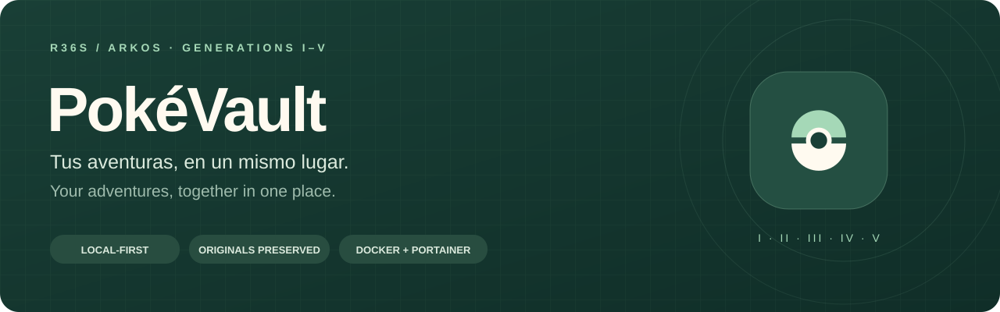

<p align="center"></p>

<p align="center"><a href="README.md">Español</a> · <strong>English</strong></p>
<p align="center">
  <a href="https://github.com/AyoseMedina/PokeVault/actions/workflows/ci.yml"></a>
  <a href="LICENSE"></a>
  
  <a href="GETTING_STARTED.md#docker-and-portainer-from-github"></a>
</p>

# PokéVault · Your classic HOME

A personal bank for collecting, organizing and preparing copies of your generation I–V Pokémon, designed for R36S / ArkOS. **Your save files are processed and stored in your browser.** No save uploads, analytics or JavaScript runtime dependencies.

The code is public and you can host the application on your own computer or server. Docker includes **personal sign-in validated server-side**, and cloud mode adds automatic HTTPS with Caddy. Save files are generated locally and installed on the console manually. The bank interface is in Spanish; sign-in and documentation support Spanish and English. Access-server dependencies are separate from browser code.

**[Get started](GETTING_STARTED.md) · [Docker and Portainer](GETTING_STARTED.md#docker-and-portainer-from-github) · [Changelog](CHANGELOG.en.md) · [Contribute](CONTRIBUTING.md#english)**

## What you can do

| Feature | Description |
| --- | --- |
| Import adventures | Read parties and boxes from 13 games, check structures and checksums, and preserve original bytes with SHA-256. |
| Organize your bank | Create virtual boxes with 30 slots, search, filter, sort, favorite Pokémon and add notes. Bank organization does not alter the save's boxes. |
| Prepare copies | Select PC Pokémon, review the route and changes, and write only to empty slots in a new save file. |
| Keep backups | Export a portable `.pvault` bank, merge backups, and restore the last 25 organization snapshots. |
| Install with context | Download a ZIP with originals, output, manifest and manual R36S / ArkOS instructions. |
| Explore first | Try a demo with synthetic, non-playable data before importing your own saves. |
| Protect access | ES/EN sign-in, scrypt password hashes, expiring sessions, throttling and logout without deleting the bank. |

## Quick start

```bash
git clone https://github.com/AyoseMedina/PokeVault.git
cd PokeVault
```

[Create your credentials](GETTING_STARTED.md#create-your-credentials-once) and save them in `.env` or Portainer. There is no default password. Then:

```bash
docker compose up -d --build
```

Open **http://localhost:8080** on the Docker computer.

For Portainer: repository `https://github.com/AyoseMedina/PokeVault`, reference `refs/heads/main`, **Docker Standalone**. Choose `compose.yaml` for local or `compose.cloud.yaml` for cloud. In cloud mode, set `POKEVAULT_DOMAIN` once your domain and DNS are ready; Caddy obtains and renews the certificate. Follow the [deployment guide](GETTING_STARTED.md#create-the-stack).

The original static mode remains available for local development **without sign-in**: run `py iniciar.py` on Windows or `python3 iniciar.py` on Linux/macOS and open **http://127.0.0.1:8000**, without installing packages. Do not expose it to the Internet.

> The bank lives in IndexedDB, not Docker or GitHub. Export a `.pvault` before changing browser, domain, protocol or port; every web origin has its own storage.

Sign-in protects web access; it does not encrypt IndexedDB or separate accounts within one browser profile. See [protections, recovery and limitations](docs/ACCESS.md#english).

## Games and formats

| Generation | Supported games | Battery size | PC boxes |
| --- | --- | --- | --- |
| I | International Yellow | 32 KiB | 12 |
| II | International Crystal | 32 KiB | 14 |
| III | International FireRed and Emerald | 128 KiB | 14 |
| IV | Diamond, Pearl, Platinum, HeartGold and SoulSilver | 512 KiB | 18 |
| V | Black, White, Black 2 and White 2 | 512 KiB | 24 |

Party Pokémon are also read. DS supports raw SAV/SRM and DSV with recognized 40- or 122-byte footers; the complete file is retained. ROM hacks, savestates, compressed No$GBA batteries and GB RTC tails are unsupported.

## Copy exports

Every operation preserves source Pokémon and saves and produces a new file. Copies do not trigger trade evolutions, simulate a Link Cable or official transfer minigames, or change the Pokédex, bag or progress.

| Route | Support |
| --- | --- |
| I→I, II→II, III→III, IV→IV, V→V | Same-generation copying with language, form and item restrictions. |
| I→II | Time Capsule conversion: raw data, names, DVs, EVs and EXP preserved; friendship 70 and native catch-rate-to-item mapping. |
| III→IV | Pal Park: PID, ID32, EXP, EVs, IVs, Gen III ability, nature, ribbons and names; location 55, explicit date, friendship 70 and Gen IV PP. |
| IV→V | Poké Transfer: PID, IVs, nature, names and data; location 30001, explicit date, friendship 70 and Gen V PP. |
| III→V | Chained III→IV→V conversion. |
| II→III, routes crossing that gap, and backward transfers | Blocked. |

Eggs, Pokémon outside the PC, source held items, quarantined destinations, duplicates, occupied slots and incompatible languages are blocked. Conversions reject HMs instead of deleting them, fateful-encounter events, unsupported forms and lossy text conversions. This is a conservative policy, not competitive legality analysis. GTS, Day Care, Pokéwalker and Battle Box data are not extracted.

The conversion date is fixed during review using Atlantic/Canary time. Exported bytes must exactly match the reviewed result. The ZIP includes originals, output, instructions and a manifest with file and entity hashes, route, date and changes.

## Write safeguards

- Only empty slots are used. The output is parsed again, each inserted Pokémon is checked and existing Pokémon must remain unchanged. A write-range mask blocks changes outside authorized regions.
- Yellow updates the active box and mirror, plus main, bank and per-box checksums. Uninitialized inactive boxes are blocked.
- Crystal updates lists and the active mirror, preserving the previous main backup together with its separate checksum. PC boxes are outside the main checksum.
- Gen III updates only PC slots and their sector checksums, keeping the other internal save copy.
- Gen IV writes to active storage and updates its CRC; HGSS records the changed box. General data and the previous copy remain intact.
- Gen V updates the box block, its local/mirrored checksum and the checksum-table CRC. Backup and auxiliary data are retained.
- DSV output keeps the exact original length and footer and is exported as DSV.
- A copy is retained on import and another before export. The bank keeps organization restore points and a portable `.pvault` backup. A revision check prevents overwriting changes from another tab.

## Development and verification

Serve `dist` with a static server; no installation step is needed. `node --test tests/*.test.js` checks integrity, formats, writes and conversions. Save fixtures are synthetic and non-playable and are never included in `dist`. Public PKHeX entities are also used, and fields are checked against original specifications. Tests do not replace checking a real save copy in an emulator or on an R36S.

With Node.js 22 or newer:

```bash
npm test
```

The save suite contains 62 tests and needs no package installation. The access server adds 14 tests: install with `npm --prefix server ci --ignore-scripts`, then run `npm run test:auth`. Generated files go to `.test-output/`. GitHub Actions checks both suites, login, logout, Docker and cloud configuration. It does not publish the website or a registry image.

## Project map

| Path | Responsibility |
| --- | --- |
| `dist/app.js` | UI, IndexedDB, bank, backups, review and export. |
| `dist/core.js` | GB/GBA reading, shared validation, SHA-256, ZIP and Gen III writing. |
| `dist/formats.js` | Yellow/DS reading, DSV containers and DS entity encryption. |
| `dist/transfer.js` | Routes, conversions and GB/DS copy writing. |
| `dist/*data.js` | Species, text and conversion tables with documented provenance. |
| `dist/styles.css`, `dist/sprites/` | Responsive layout and 649 local sprites. |
| `tests/` | Tests and public reference entities. |
| `server/` | Access server, ES/EN screen, credential generator and tests. |
| `Dockerfile`, `compose.yaml`, `compose.cloud.yaml`, `docker/` | Local login and Caddy HTTPS deployment in Docker / Portainer; previous Nginx config retained. |
| `iniciar.py` | Python server bound to `127.0.0.1`. |
| `AGENTS.md` | Development and data-protection rules; [English translation](AGENTS.en.md). |

## Documentation in two languages

| Document | Español | English |
| --- | --- | --- |
| Overview, compatibility and architecture | [README](README.md) | [README](README.en.md) |
| Setup, Docker and Portainer | [Empezar](EMPEZAR.md) | [Getting started](GETTING_STARTED.md) |
| Change history | [Historial](CHANGELOG.md) | [Changelog](CHANGELOG.en.md) |
| Development rules | [Pautas](AGENTS.md) | [Guidelines](AGENTS.en.md) |
| Contributions | [Guía bilingüe](CONTRIBUTING.md#español) | [Bilingual guide](CONTRIBUTING.md#english) |
| Test entities and attribution | [Procedencia](tests/fixtures/README.md#español) | [Provenance](tests/fixtures/README.md#english) |
| Login and security | [Acceso](docs/ACCESS.md#español) | [Access](docs/ACCESS.md#english) |

## Sources and license

Original JavaScript implementation under GPL-3.0. Tables and references from [kwsch/PKHeX](https://github.com/kwsch/PKHeX), © its authors: PK1/PK3/PK4, SAV1/SAV2/SAV3/SAV4/SAV5, StringConverter345, SpeciesName, personal_e and MoveInfo4/5. See [LICENSE](LICENSE), also retained at `dist/LICENSE`. Native references include [pret/pokeyellow](https://github.com/pret/pokeyellow), [pret/pokecrystal](https://github.com/pret/pokecrystal), [pret/pokeemerald](https://github.com/pret/pokeemerald) and [pret/pokefirered](https://github.com/pret/pokefirered). Local tables are in `data.js`, `formats-data.js` and `transfer-data.js`.

Reference entities: [tests/fixtures/README.md](tests/fixtures/README.md). Species and growth data: [PokéAPI](https://github.com/PokeAPI/pokeapi). Local sprites through species 649: [PokeAPI/sprites](https://github.com/PokeAPI/sprites). Images and characters belong to The Pokémon Company. This is an unofficial personal project.
