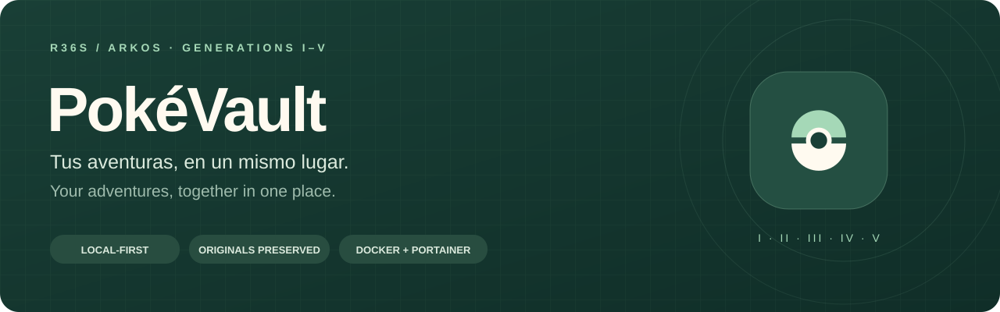

<p align="center"></p>

<p align="center"><strong>Español</strong> · <a href="README.en.md">English</a></p>
<p align="center">
  <a href="LICENSE"></a>
  
  <a href="EMPEZAR.md#docker-y-portainer-desde-github"></a>
</p>

# PokéVault · Tu HOME clásico

Un banco personal para reunir, organizar y preparar movimientos de tus Pokémon de generaciones I–V, pensado para R36S / ArkOS. **Tus guardados se procesan y conservan en tu navegador.** No se suben partidas, no hay analítica ni dependencias JavaScript de ejecución.

El código es público y la aplicación se puede alojar en tu propio equipo o servidor. Docker incluye un **login personal validado en el servidor**, y el despliegue en Portainer utiliza tu Nginx existente con el puerto interno 8080. Los archivos de guardado se generan localmente y se instalan manualmente en la consola. La interfaz del banco está en español; el login y la documentación están disponibles en español e inglés. Las dependencias del servidor de acceso están separadas del código del navegador.

**[Empezar](EMPEZAR.md) · [Docker y Portainer](EMPEZAR.md#docker-y-portainer-desde-github) · [Historial](CHANGELOG.md) · [Contribuir](CONTRIBUTING.md)**

## Qué puedes hacer

| Función | Descripción |
| --- | --- |
| Importar aventuras | Leer equipo y cajas de 16 juegos, comprobar estructura y checksums y conservar los bytes originales con SHA-256. |
| Organizar tu banco | Crear cajas virtuales de 30 casillas, buscar, filtrar, ordenar, marcar favoritos y añadir notas. La organización no altera las cajas de la partida. |
| Mover Pokémon | Retirarlos del resultado de origen e insertarlos en casillas libres del destino, con revisión, evoluciones y Pokédex. |
| Guardar respaldos | Exportar un banco portátil `.pvault`, fusionar respaldos y recuperar los últimos 25 estados de organización. |
| Instalar con contexto | Descargar un ZIP con originales, resultado, manifiesto y guía manual para R36S / ArkOS. |
| Explorar primero | Usar una demo con datos sintéticos no jugables antes de importar tus partidas. |
| Consultar la Pokédex | Marcas reales de vistos/capturados por partida, búsqueda, filtros y descripciones de la edición; [cobertura e idiomas](docs/POKEDEX.md). |
| Proteger el acceso | Login ES/EN, contraseñas con hash scrypt, sesiones con caducidad, límites de intentos y cierre de sesión sin borrar el banco. |

La aplicación y el login usan una paleta de Poké Ball: rojo, blanco y negro.

La interfaz se adapta a móviles y tabletas: menú con todas las secciones, controles táctiles, cajas, Pokédex y revisión/exportación a todo el ancho. Para mover Pokémon sin arrastrar, marca su selector y pulsa **Mover de caja**.


El banco guarda los originales una sola vez por hash. La demo no sustituye un
banco real; las partidas ilegibles quedan en cuarentena y pueden descargarse.
Copias de seguridad muestra persistencia/cuota y recuerda exportar el `.pvault`
tras cambios o siete días. La persistencia la decide el navegador y no sustituye
un respaldo externo. El `.pvault` v2 incluye originales, respaldos e historial;
se siguen leyendo archivos v1. [Migración, recuperación y pruebas](docs/VALIDATION.md).

## Inicio rápido

```bash
git clone https://github.com/AyoseMedina/PokeVault.git
cd PokeVault
```

[Crea tus credenciales](EMPEZAR.md#crear-tus-credenciales-una-vez) y guárdalas en `.env` o en Portainer. No hay contraseña por defecto. Después:

```bash
docker compose up -d --build
```

Abre **http://localhost:8080** en el equipo Docker.

Para Portainer: repositorio `https://github.com/AyoseMedina/PokeVault`, referencia `refs/heads/main` y **Docker Standalone**. Usa **`docker-compose.yml`** para tu Nginx: solo la aplicación, sin puertos de host ni redes externas preconfiguradas. Tú conectas la red del proxy en Portainer. Configura las credenciales, `POKEVAULT_ORIGIN` y `POKEVAULT_TRUST_PROXY`. Se conserva `compose.yaml` para local y `compose.cloud.yaml` como opción con Caddy si no tienes proxy. Sigue la [guía de despliegue](EMPEZAR.md#crear-el-stack).

El modo estático original se conserva para desarrollo local **sin login**: `py iniciar.py` en Windows o `python3 iniciar.py` en Linux/macOS, en **http://127.0.0.1:8000**, sin instalar paquetes. No lo expongas a Internet.

> El banco está en IndexedDB, no en Docker ni en GitHub. Exporta un `.pvault` antes de cambiar de navegador, dominio, protocolo o puerto; cada origen web tiene su propio almacenamiento.

El login protege el acceso web; no cifra IndexedDB ni separa cuentas dentro de un mismo perfil de navegador. Consulta [protecciones, recuperación y límites](docs/ACCESS.md).

## Juegos y formatos

- Gen I: Amarillo internacional, 32 KiB, 12 cajas y equipo.
- Gen II: Cristal internacional, 32 KiB, 14 cajas y equipo.
- Gen III: Rubí, Zafiro, Esmeralda, Rojo Fuego y Verde Hoja internacionales, 128 KiB, 14 cajas y equipo.
- Gen IV: Diamante, Perla, Platino, HeartGold y SoulSilver, 512 KiB, 18 cajas y equipo.
- Gen V: Negro, Blanco, Negro 2 y Blanco 2, 512 KiB, 24 cajas y equipo.
- DS acepta RAW SAV/SRM y DSV con pie reconocido de 40 o 122 bytes. El archivo completo se conserva. No se admiten ROM hacks, savestates, baterías comprimidas de No$GBA ni colas RTC de GB.

Los textos de Pokédex son referencias incluidas localmente, no extraídas del guardado. La fuente fijada incluye inglés para estas ediciones, pero no español; se indica el idioma y nunca se sustituye por texto de otro juego.

## Exportación de movimientos

La política [pokevault-move-v1](docs/MOVE_TRANSFER.md) genera un archivo por origen y otro para el destino. Los Pokémon salen de los resultados de origen. Los bytes importados permanecen intactos. El ZIP conserva nombres/extensiones exactos en `copiar-a-la-SD/<gb|gbc|gba|nds>/`: instala **todos los resultados o ninguno**, comprobando cada hash `before` de la SD. Evoluciones activas en misma generación, I→II y II→III personalizada; nunca en III→IV/IV→V. La Pokédex registra especies recibidas y evolucionadas. Los objetos siguen [tablas generadas](docs/ITEM_TRANSFER.md); IV→V los devuelve a la mochila del origen. No se simulan cable Link ni minijuegos.

| Ruta | Soporte |
| --- | --- |
| I→I, II→II, III→III, IV→IV, V→V | Movimiento con evolución por intercambio y restricciones de idioma/formas/objetos |
| I→II | Conversión de Cápsula del Tiempo: raw, nombres, DVs, EVs y EXP conservados; amistad70 y mapa nativo de tasa de captura a objeto |
| III→IV | Parque Compi: PID, ID32, EXP, EVs, IVs, habilidad GenIII, naturaleza, cintas y nombres; procedencia55, fecha explícita, amistad70 y PP GenIV |
| IV→V | Pokétransfer: PID, IVs, naturaleza, nombres y datos; procedencia30001, fecha explícita, amistad70 y PP GenV |
| III→V | Cadena III→IV→V |
| Cristal II→III | Conversión personalizada opcional a Rubí/Zafiro/Esmeralda/Rojo Fuego/Verde Hoja; revisión de campos generados y estadísticas adaptadas. [Política y límites](docs/CUSTOM_TRANSFER.md). |
| Saltos directos II→IV/V y envíos hacia atrás | Bloqueados |

Se bloquean huevos, Pokémon fuera del PC, Cartas y objetos incompatibles, destinos en cuarentena, duplicados, casillas ocupadas e idiomas no compatibles. Las conversiones rechazan MO en vez de borrarlas, eventos con fateful, formas no soportadas y recodificaciones con pérdida. La política es conservadora; no es un análisis de legalidad competitiva. No se extraen GTS, guardería, Pokéwalker o caja de combate.

La fecha se fija en la revisión, usando Atlantic/Canary. Los bytes producidos al exportar deben coincidir exactamente con los aprobados. El ZIP incluye originales, todos los resultados, instrucciones y manifiesto con hashes de archivos y entidades, ruta, fecha y cambios.

Las versiones utilizadas quedan consumidas: no se seleccionan ni reimportan,
incluso desde `originales/`. La marca se conserva en `.pvault` y tras retirar una
versión del banco. **Anular exportación** requiere confirmar que no se instaló
ningún resultado y queda registrado. Importa los nuevos guardados para continuar.
Este control es local: no impide manipular archivos o borrar bancos externamente.

Indica el **idioma del juego** al importar GB/GBA; IV/V lo leen del guardado.
Los bancos GBA antiguos piden confirmarlo antes de renombrar una evolución.
Bloqueos pendientes: formas no base con registro de Pokédex V, renombrado de
evoluciones extranjeras sin mote en V y renombrados R/S ambiguos según revisión
de ROM. [Fuentes, comportamiento y límites](docs/MOVE_IMPLEMENTATION.md).

## Garantías de escritura

- Solo se insertan en huecos libres. Se analiza el resultado, se comprueba cada Pokémon insertado y que los anteriores sigan iguales. Una máscara de rangos bloquea cambios fuera de las zonas autorizadas.
- Amarillo actualiza caja activa/espejo y checksums principal, de banco y por caja. Las cajas inactivas sin inicializar se bloquean.
- Cristal actualiza listas y espejo activo; actualiza las marcas Pokédex autorizadas en principal/respaldo y ambos checksums. Los PC están fuera del checksum principal.
- Gen III actualiza casillas PC, Pokédex y espejos y sus checksums; conserva la otra copia interna.
- Gen IV escribe en el almacenamiento activo y actualiza su CRC; HGSS registra la caja modificada. Se actualiza la Pokédex general y, en el origen IV→V, la mochila; la partición anterior se conserva.
- Gen V actualiza el bloque de caja, su checksum local/espejo y el CRC de la tabla de checksums. Se conserva el backup y datos auxiliares.
- DSV mantiene longitud y pie exactos; se exporta como DSV.
- Se conserva una copia al importar y otra antes de exportar. El banco guarda puntos de restauración de organización y un respaldo portátil .pvault. El control de revisión evita sobrescribir cambios desde otra pestaña.

## Desarrollo y verificación

Sin instalación: servir `dist` con un servidor estático. `node --test tests/*.test.js` comprueba integridad, formatos, escritura y conversiones. Las fixtures de guardado son sintéticas y no jugables; nunca se incluyen en `dist`. Se usan también entidades públicas de PKHeX y se contrastan campos con las especificaciones originales. Las pruebas no sustituyen la comprobación de una copia real en el emulador o R36S.

Con Node.js 22 o posterior:

```bash
npm test
```

La suite de guardados contiene 97 pruebas y no requiere instalar paquetes. El servidor de acceso tiene 18 pruebas adicionales: instala con `npm --prefix server ci --ignore-scripts` y ejecuta `npm run test:auth`. Los archivos generados van a `.test-output/`. Las comprobaciones se ejecutan localmente; no hay workflows de GitHub Actions. Portainer construye directamente desde Git.

Pruebas del banco en IndexedDB y navegador aislado: `npm run test:browser`. Consulta [preparación y cobertura](docs/VALIDATION.md).

## Mapa del proyecto

| Ruta | Responsabilidad |
| --- | --- |
| `dist/app.js` | Interfaz, IndexedDB, banco, respaldos, revisión y exportación. |
| `dist/core.js` | Lectura GB/GBA, validación común, SHA-256, ZIP y escritura Gen III. |
| `dist/formats.js` | Lectura de Amarillo/DS, contenedores DSV y cifrado de entidades DS. |
| `dist/move*.js` | Movimiento, objetos, evoluciones y Pokédex; tablas reproducibles. |
| `dist/transfer.js` | Rutas, conversiones y escritura de copias en GB/DS. |
| `dist/*data.js` | Tablas de especies, texto y conversión con procedencia documentada. |
| `dist/styles.css`, `dist/sprites/` | Diseño adaptable y 649 sprites locales. |
| `tests/` | Pruebas y entidades públicas de referencia. |
| `dist/pokedex*.js`, `dist/custom-transfer*.js` | Pokédex de solo lectura, descripciones locales y conversión Cristal → GBA con activación explícita. |
| `server/` | Servidor de acceso, pantalla ES/EN, generador de credenciales y pruebas. |
| `Dockerfile`, `docker-compose.yml`, `compose.yaml`, `compose.cloud.yaml`, `docker/` | Portainer con Nginx existente, login local y Caddy opcional; configuración Nginx anterior conservada. |
| `iniciar.py` | Servidor Python limitado a `127.0.0.1`. |
| `AGENTS.md` | Reglas de desarrollo y protección de datos; [traducción inglesa](AGENTS.en.md). |

## Documentación en dos idiomas

| Documento | Español | English |
| --- | --- | --- |
| Presentación, compatibilidad y arquitectura | [README](README.md) | [README](README.en.md) |
| Inicio, Docker y Portainer | [Empezar](EMPEZAR.md) | [Getting started](GETTING_STARTED.md) |
| Historial de cambios | [Historial](CHANGELOG.md) | [Changelog](CHANGELOG.en.md) |
| Pautas de desarrollo | [Pautas](AGENTS.md) | [Guidelines](AGENTS.en.md) |
| Contribuciones | [Guía bilingüe](CONTRIBUTING.md#español) | [Bilingual guide](CONTRIBUTING.md#english) |
| Entidades de pruebas y atribución | [Procedencia](tests/fixtures/README.md#español) | [Provenance](tests/fixtures/README.md#english) |
| Login y seguridad | [Acceso](docs/ACCESS.md#español) | [Access](docs/ACCESS.md#english) |

## Fuentes y licencia

Implementación JavaScript original bajo GPL-3.0. Tablas y referencias de [kwsch/PKHeX](https://github.com/kwsch/PKHeX), © sus autores: PK1/PK3/PK4, SAV1/SAV2/SAV3/SAV4/SAV5, StringConverter345, SpeciesName, personal_e y MoveInfo4/5. Licencia en [LICENSE](LICENSE), conservada también en `dist/LICENSE`. Fuentes nativas contrastadas en [pret/pokeyellow](https://github.com/pret/pokeyellow), [pret/pokecrystal](https://github.com/pret/pokecrystal), [pret/pokeemerald](https://github.com/pret/pokeemerald) y [pret/pokefirered](https://github.com/pret/pokefirered). Tablas locales en `data.js`, `formats-data.js` y `transfer-data.js`.

Entidades de referencia: `tests/fixtures/README.md`. Datos de especies y crecimiento: [PokéAPI](https://github.com/PokeAPI/pokeapi). Sprites locales hasta especie649: [PokeAPI/sprites](https://github.com/PokeAPI/sprites). Imágenes y personajes pertenecen a The Pokémon Company. Proyecto personal no oficial.
